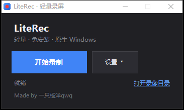

<div align="center">

# LiteRec

**92 KB 的 Windows 原生录屏工具**

单文件 · 免安装 · 零依赖 · 零后台常驻

[](https://github.com/USER/LiteRec/actions/workflows/build.yml)
[](LICENSE)
[](#为什么只有-92-kb)
[](#系统要求)

[下载](https://github.com/USER/LiteRec/releases/latest) · [为什么这么小](#为什么只有-92-kb) · [实测数据](#实测数据) · [已知限制](#已知限制) · [自己编译](#自己编译)

</div>



---

## 为什么只有 92 KB

因为**没有打包任何东西**——编码器用的是 Windows 自带的 Media Foundation，运行时用的是系统自带的 .NET Framework。

| 常见录屏软件 | LiteRec |
| --- | --- |
| 100–500 MB，塞一整套 FFmpeg / Qt / Electron | **92 KB**，单个 exe |
| 需要安装、写注册表、装服务 | 复制即用，删掉即卸载 |
| 常驻托盘、开机自启 | 只在运行时存在 |

其中 26 KB 还是图标（按 Windows 规范提供 16/20/24/32/48/256 六个尺寸，任务栏、Alt-Tab、资源管理器都不糊）。

## 功能

- **MP4 (H.264 + AAC)** —— 硬件编码，1080p30 基本满帧，**带系统声音**
- **AVI (MJPEG)** —— 纯托管兜底方案，编码器不可用时自动回退
- 全屏 / 拖拽框选区域
- **可自定义全局快捷键**（默认 F9，支持 Ctrl/Shift/Alt 组合），最小化也生效
- **可隐藏悬浮控制条** —— 录游戏/全屏时画面干净，只靠快捷键控制
- 窗口置顶的实时控制条：时长、帧率、文件大小
- 鼠标指针开关、帧率 5–120、画质 10 档
- 保存位置自定义，**录制前先做真实写入测试**（盘拔了/无权限会立刻告诉你，不让你白录）

## 用法

1. 下载 `LiteRec.exe`，双击
2. 点 **开始录制**（默认全屏；先在设置里切"选择区域"可框选）
3. 点控制条的方块停止，或按 **F9**
4. 录像在 `我的视频\LiteRec\`（可改）

| 操作 | 说明 |
| --- | --- |
| **F9** | 全局热键，开始/停止，窗口最小化也生效，可改 |
| 拖动控制条 | 放到任意角落 |
| 框选区域 | 拖拽，双击 = 全屏，Esc = 取消 |

设置存在 `%APPDATA%\LiteRec\settings.ini`，是纯文本，可以直接改。

## 关于声音

录的是**电脑里播放的声音**（WASAPI 环路捕获），不是麦克风。

```
WASAPI loopback → PCM16 → AAC 128kbps → MP4 第二条音轨
```

- 默认开启，可在设置里关
- **仅 MP4 支持**，AVI 容器没有音轨
- 音频启动失败时会**立刻弹窗告诉你**，不会让你录完才发现是静音文件

## 实测数据

测试机：Windows 10 / i5 级 CPU / GT 730 / 1920×1080 单屏

| 场景 | 结果 |
| --- | --- |
| MP4 1080p30 录制 | **28–30 fps**（基本满帧） |
| 录制内存 | 稳定 120–180 MB |
| 空闲内存 | 28 MB |
| exe 体积 | 92 KB |
| AVI 1080p | 18–20 fps（软件 JPEG，兜底用） |

> 后台同时跑一堆服务 + 两个浏览器 + 一款游戏时，仍能维持 20+ fps。内存大头是 H.264 编码器本身（约 120 MB），不是程序驻留——这是硬件编码的固有开销，任何同类软件都省不掉。

## 系统要求

- Windows 10 / 11（64 位）
- .NET Framework 4.x（Win10 以上系统自带）
- 无需管理员权限

## 自己编译

**不需要 Visual Studio，也不需要任何 SDK。**

```cmd
build.cmd
```

只调用系统自带的 `C:\Windows\Microsoft.NET\Framework64\v4.0.30319\csc.exe`（C# 5 语法）。

命令行自测：

```cmd
LiteRec.Test.exe mp4 3          :: 录 3 秒 MP4（640×360 区域）
LiteRec.Test.exe avi 3          :: 录 3 秒 AVI
LiteRec.Test.exe mp4 3 full     :: 录 3 秒全屏
LiteRec.Test.exe mp4 3 audio    :: 录 3 秒 MP4 + 系统声音（自动播放测试音调）
```

输出在 `%TEMP%\LiteRecTest\`。

## 已知限制

诚实地说，GDI `BitBlt` 抓屏有物理上限：

- **流畅**：2D 游戏（如星露谷物语）、桌面操作、软件演示 —— 1080p30 实测流畅清晰
- **可能掉帧**：全屏 3D 大作、浏览器高码率视频、60fps 剧烈运动
  （单帧采集约 31 ms，而 30fps 的预算是 33.3 ms，正好卡在临界点）
- **只录系统声音，不录麦克风**
- **AVI 帧率偏低**（GDI+ 软件 JPEG，1080p 约 58 ms/帧）
- 多显示器只能整块虚拟桌面录制，不能逐个选

根治掉帧需要把采集层换成 DXGI Desktop Duplication 或 Windows Graphics Capture，本项目暂未实现。

## 技术笔记

手写这些 COM interop 踩过的坑，比代码本身更值钱：

<details>
<summary><b>1. IMFSample 的 QueryInterface 会返回 E_NOINTERFACE</b></summary>

`MFCreateSample` 返回的对象，对 `IMFSample` 做 QI 会失败，但按 vtable 直接调用所有方法都返回 `S_OK`。
所以 `MfNative.cs` 完全绕开 QI，按 vtable 下标直调
（`SetSampleTime`=36、`AddBuffer`=42），并用时间值往返实测确认过布局。
</details>

<details>
<summary><b>2. MF_MT_DEFAULT_STRIDE 必须取正值</b></summary>

DIB 是自上而下的，按直觉该给负 stride——但实测负值会让画面**上下翻转**。
只有正 `width*4` 才和屏幕一致。用上红下蓝的测试帧做了确定性验证才定下来。
</details>

<details>
<summary><b>3. 必须显式开启硬件编码器</b></summary>

不设 `MF_READWRITE_ENABLE_HARDWARE_TRANSFORMS` 就会走软件编码，
1080p 帧率在 14–31 fps 之间剧烈抖动；开启后稳定 28–29 fps。
</details>

<details>
<summary><b>4. 音频 COM 接口的 vtable 是「声明顺序」，不是「调用顺序」</b></summary>

手写 WASAPI loopback 时把所有调用都写崩了（`AccessViolationException`）。
根因：`IAudioCaptureClient` 在 `audioclient.h` 里声明为
`GetBuffer(slot3) / ReleaseBuffer(slot4) / GetNextPacketSize(slot5)`，
而直觉会按调用顺序排成 `GNPS / GetBuffer / ReleaseBuffer`。
错一位 → 用 1 个参数去调 5 个参数的 `GetBuffer` → 破坏调用栈 → 必崩。

同理 `IAudioClient`：`3=Init / 8=GetMixFormat / 10=Start / 11=Stop / 14=GetService`。

**教训：判定 COM 接口是否正常，绝不能只看「初始化全 S_OK」。**
</details>

<details>
<summary><b>5. 无 SDK 头文件时如何构造音频媒体类型</b></summary>

音频属性 GUID（`MF_MT_AUDIO_*`）无从查证，于是改用
`MFInitMediaTypeFromWaveFormatEx`，把一个 `WAVEFORMATEX` 结构丢给 MF 让它自己填。
</details>

<details>
<summary><b>6. 按真实时间戳写帧，而不是按帧序号</b></summary>

否则一旦掉帧，成品视频会加速播放、时长对不上。
</details>

<details>
<summary><b>7. 零拷贝送帧</b></summary>

DIB 内存直接 `RtlMoveMemory` 进 MF 缓冲，避免每帧分配 8 MB 托管数组。
</details>

<details>
<summary><b>8. 图标只嵌一份，运行期从自己的 PE 资源读回</b></summary>

常见做法是 `/win32icon` 加 `/resource` 嵌两次，体积直接翻倍。
这里只用 `/win32icon`，启动时用 `PrivateExtractIcons` 从自身 exe 取图标。

另外：.NET 的 `Icon` 类**无法**解码自拼的 BMP 条目，
但 Windows 的 `LoadImage` / `PrivateExtractIcons` 都能正常读。
判断 ico 是否有效必须走 Windows 的加载路径。
</details>

## 源码结构

| 文件 | 职责 |
| --- | --- |
| `Program.cs` | 入口、DPI 感知、从自身 PE 资源取图标、全局异常兜底 |
| `MainForm.cs` | 主窗口、设置面板、录制流程编排 |
| `ControlBar.cs` | 置顶控制条（红点 / 时长 / 帧率 / 停止） |
| `RegionSelector.cs` | 全屏遮罩框选 |
| `ScreenCapture.cs` | GDI BitBlt 抓屏 + 复用 DIB 段 + 光标叠加 |
| `Recorder.cs` | 录制引擎：后台线程、定速节拍、掉帧补偿 |
| `Mp4Writer.cs` | MF SinkWriter 写 H.264 视频 + AAC 音频 |
| `AviWriter.cs` | 自写 MJPEG-AVI 封装（零依赖兜底） |
| `AudioCapture.cs` | WASAPI 环路捕获系统声音（裸 vtable） |
| `MfNative.cs` | MF 原生 vtable 访问层 |
| `Interop.cs` | Win32 / MF 常量与 P/Invoke 声明 |
| `Settings.cs` | 配置读写与容错 |
| `GlobalHotkey.cs` | 系统级全局热键 |

图标由 `tools/IconGen.cs` 用代码生成，不需要任何设计工具。

## License

[MIT](LICENSE) © 2026 一只杨洋qwq

---

<div align="center">

**English TL;DR**

LiteRec is a **92 KB** portable screen recorder for Windows 10/11.
No installer, no dependencies, no background service.
Uses the built-in Media Foundation encoder for H.264 + AAC and .NET Framework for the UI,
so the whole program fits in a single 92 KB executable.

Features: full-screen or region capture, customizable global hotkey,
hideable overlay bar, system audio via WASAPI loopback, hardware-accelerated MP4.

Build with `build.cmd` — no Visual Studio or SDK required.

Known limits: GDI capture works great for desktop / 2D games at 1080p30,
but may drop frames on full-screen 3D or 60fps content.
System audio only (no microphone).

</div>
